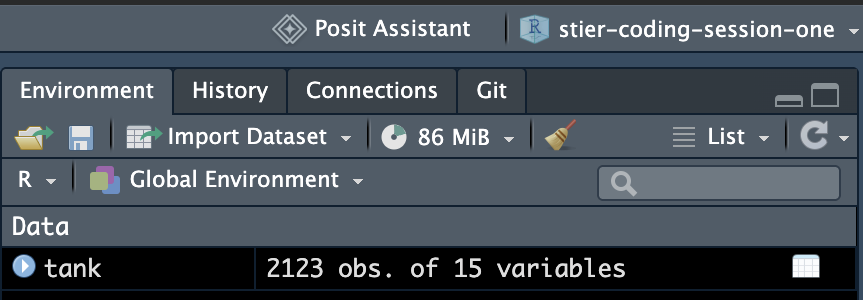
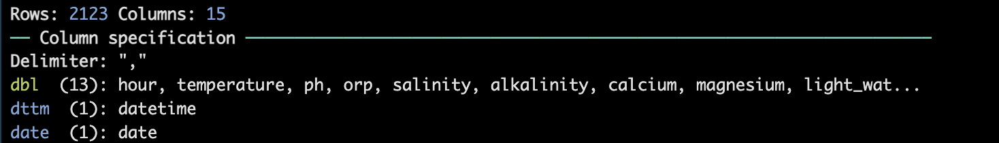
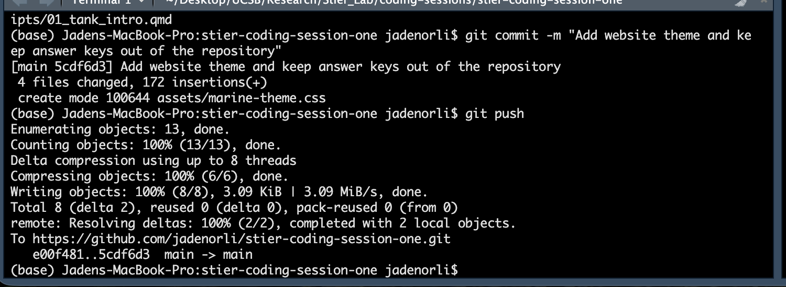

## Welcome back!

Last week we installed everything. **Today, we finally get to the data.**

| Time | What |
|---|---|
| 0 to 5 minutes | Quick check that everything still works |
| 5 to 15 minutes | Get your own copy of the activity |
| 15 to 50 minutes | Explore two weeks of data from our reef tank |
| 50 to 60 minutes | Save your work to GitHub |

## Quick check: still connected?

Open RStudio and run this in the **Console**:

```r
usethis::git_sitrep()
```

| Line | Should show |
|---|---|
| `Name` and `Email` | Your name and GitHub email |
| `Personal access token for 'https://github.com'` | `<discovered>` |
| `GitHub user` | Your GitHub username |

::: {.callout-box}
**Something missing?** Raise your hand. The setup slides from last week are in the repository too.
:::

## Get your own copy of the activity

1. Go to **<https://github.com/jadenorli/stier-coding-session-one>**
2. Click **Use this template**, then **Create a new repository**
3. **Owner:** you. **Name:** `stier-coding-session-one`. **Public**, then **Create repository**
4. On **your new repository**, click **Code** and copy the `https://` link
5. In RStudio: **File**, then **New Project**, then **Version Control**, then **Git**. Paste the link and click **Create Project**

::: {.callout-box}
Check the link before you paste it: it should contain **your** username, not `jadenorli`.
:::

::: notes
Do this live with a demo copy named session-one-demo (check "Open in new session" so your template project stays open). Point at the new repository's name: "See jadenorli/session-one-demo? Yours should have your username."
:::

## Open the activity

1. In the **Files** tab, open `scripts/01_tank_intro.qmd`
2. Click **Render**. A web page with the whole activity opens.

| To run | Do this |
|---|---|
| One line | Cursor on the line, then **Command + Enter** (Mac) or **Control + Enter** (Windows) |
| A whole chunk | Click the green ▶ in the chunk's top right corner |
| The whole document | Click **Render** |

::: {.small}
The coral error boxes are the blanks you will fill in. That's expected!
:::

## The data: our reef tank

- The tank's **Apex** controller records readings **every 10 minutes**
- Two weeks: **October 9 to October 23, 2026**
- Water chemistry: temperature, pH, salinity, oxidation reduction potential
- Equipment power: lights, heater, pumps
- Something unusual happened on **October 21**. Can you find it?

::: notes
Do not give away the pump outage. Let them find it in Parts 4 and 5.
:::

## R idea 1: objects and the arrow

The arrow `<-` saves something under a name, so you can use it later.

```r
tank <- read_csv("../data/tank_data.csv")
```

Read it as: "read the CSV file, and **save it as** `tank`."

::: {.check-box}
**Check:** after you run it, `tank` shows up in the **Environment** panel (top right) with **2123 obs. of 15 variables**.
:::

::: notes
Part 1 of the activity. The ../ means "go up one folder": the activity lives in scripts, and the data lives in data.
:::

## What it looks like for me

`tank` in my **Environment** panel:

{fig-align="center" width="58%"}

And what `read_csv()` reports when it loads the data:

{fig-align="center" width="86%"}

## R idea 2: functions

A **function** takes something in, does a job, and gives something back. Functions always have parentheses.

| Function | What it does |
|---|---|
| `head(tank)` | Shows the first six rows |
| `nrow(tank)` | Counts the rows |
| `names(tank)` | Lists the column names |
| `summary(tank)` | Summarizes every column |
| `mean(...)`, `min(...)`, `max(...)` | Average, lowest, and highest values |

::: notes
Part 2 of the activity. Have everyone click tank in the Environment panel to open the spreadsheet view.
:::

## R idea 3: one column with `$`

The `$` pulls **one column** out of a table:

```r
tank$temperature
```

Then you can hand that column to a function:

```r
mean(tank$temperature)
```

::: {.check-box}
**Check:** the average temperature should be **78.39487** degrees Fahrenheit.
:::

::: notes
Part 3 of the activity. Question 2 asks for the pH average, lowest, and highest: 8.76, 8.63, and 8.85.
:::

## R idea 4: plots in layers

`ggplot` builds a plot one layer at a time, joined with `+`:

```r
ggplot(tank, aes(x = datetime, y = temperature)) +
  geom_line() +
  theme_minimal()
```

| Layer | Says |
|---|---|
| `ggplot(tank, aes(x = ..., y = ...))` | **What** to plot: which data, and which columns go on each axis |
| `geom_line()` | **How** to draw it: as a line |
| `theme_minimal()` | How it should **look** |

::: notes
Part 4 of the activity. After the first plot, ask the room: "What do you notice?" Someone will spot the dip and spike around October 21.
:::

## Tank detective: how our tank works

```{=html}
<svg viewBox="0 0 900 360" width="100%" style="max-height:380px" role="img" aria-label="Diagram of the display tank above the sump, with water flowing between them">
  <defs>
    <marker id="arrow" viewBox="0 0 10 10" refX="8" refY="5" markerWidth="7" markerHeight="7" orient="auto-start-reverse">
      <path d="M0,0 L10,5 L0,10 z" fill="#4D6C77"/>
    </marker>
  </defs>
  <rect x="200" y="20" width="500" height="120" rx="12" fill="#ffffff" stroke="#688D8D" stroke-width="3"/>
  <text x="228" y="68" font-family="Inter, sans-serif" font-size="26" font-weight="700" fill="#2E3C43">Display tank</text>
  <text x="228" y="100" font-family="Inter, sans-serif" font-size="19" fill="#43535B">where the corals live</text>
  <rect x="540" y="52" width="136" height="54" rx="8" fill="#F7ECEA" stroke="#D1796B" stroke-width="2"/>
  <text x="608" y="86" text-anchor="middle" font-family="Inter, sans-serif" font-size="21" font-weight="700" fill="#2E3C43">Heater</text>
  <rect x="200" y="220" width="500" height="120" rx="12" fill="#ffffff" stroke="#688D8D" stroke-width="3"/>
  <text x="228" y="268" font-family="Inter, sans-serif" font-size="26" font-weight="700" fill="#2E3C43">Sump</text>
  <text x="228" y="300" font-family="Inter, sans-serif" font-size="19" fill="#43535B">the tank underneath</text>
  <rect x="460" y="252" width="216" height="54" rx="8" fill="#EAF1F0" stroke="#688D8D" stroke-width="2"/>
  <text x="568" y="286" text-anchor="middle" font-family="Inter, sans-serif" font-size="20" font-weight="700" fill="#2E3C43">Temperature probe</text>
  <path d="M190 210 C 130 190, 130 150, 190 130" fill="none" stroke="#4D6C77" stroke-width="4" marker-end="url(#arrow)"/>
  <text x="100" y="168" text-anchor="middle" font-family="Inter, sans-serif" font-size="18" font-weight="700" fill="#4D6C77">Return</text>
  <text x="100" y="190" text-anchor="middle" font-family="Inter, sans-serif" font-size="18" font-weight="700" fill="#4D6C77">pump</text>
  <text x="100" y="212" text-anchor="middle" font-family="Inter, sans-serif" font-size="16" fill="#43535B">pushes up</text>
  <path d="M710 130 C 770 150, 770 190, 710 210" fill="none" stroke="#4D6C77" stroke-width="4" marker-end="url(#arrow)"/>
  <text x="805" y="178" text-anchor="middle" font-family="Inter, sans-serif" font-size="18" font-weight="700" fill="#4D6C77">Drains</text>
  <text x="805" y="200" text-anchor="middle" font-family="Inter, sans-serif" font-size="18" font-weight="700" fill="#4D6C77">down</text>
</svg>
```

::: {.small}
The heater and the temperature probe are in **different tanks**. Water only mixes between them while the return pump runs.
:::

::: notes
Show this once most people reach Part 5. The answer: the pump stopped for about 15 hours (4:00 p.m. October 21 to 7:10 a.m. October 22). The sump, with the probe, cooled to 76.4 degrees. The heater kept warming the display, which the probe could not see. When the pump restarted, warm display water reached the probe, and the reading jumped to 79.3 degrees.
:::

## Work time: Parts 1 to 5

| Part | Checkpoint |
|---|---|
| 1. Load packages and data | `tank` is in your Environment panel |
| 2. Look at the data | **Question 1:** how many readings, and how many days? |
| 3. Ask the data questions | **Question 2:** pH average, lowest, and highest |
| 4. Your first plot | A temperature plot, then one for pH |
| 5. Tank detective | **Questions 4 to 6:** what happened on October 21? |

::: {.callout-box}
**Finished early?** Try Part 6 and the challenges at the end.
:::

## Saving your work to GitHub

Git saves work in two steps: **commit** (save a snapshot on your computer) and **push** (upload it to GitHub).

1. Save the file (**Command + S** or **Control + S**)
2. In the **Git** tab (top right), check the box next to your file
3. Click **Commit**, write a short message like "Finished parts 1 to 5", and click **Commit**
4. Click **Push** (the green up arrow)

::: {.check-box}
**Check:** refresh your repository page on GitHub. Your changes should be there.
:::

## What a successful push looks like

Here's mine. The last line, ending in `main -> main`, means it worked.

{fig-align="center" width="85%"}

## When things go wrong

| Problem | Fix |
|---|---|
| `could not find function "read_csv"` or `"ggplot"` | Run the `library(tidyverse)` chunk first |
| `object 'tank' not found` | Run the Part 1 chunks. **Render** does not put objects in your Environment. |
| `'../data/tank_data.csv' does not exist` | The `.qmd` must stay in the `scripts` folder |
| Nothing shows in the **Git** tab | Save the file first |
| **Push** says permission denied | You cloned the template, not your copy. Check the link has your username. |
| **Push** asks for a password | Your token is missing. Rerun `gitcreds::gitcreds_set()` |

## Before next week

- Finish **Parts 1 to 5**, if you didn't today
- Try **Part 6: Day and night** and the challenges
- **Render**, then commit and push your work

::: {.small}
Stuck? Email me, or bring your questions next Thursday.
:::

## Coming up

| Session | Topic |
|---|---|
| 3 | R basics: objects, vectors, and functions in more depth |
| 4 | Data frames and reading in your own data |
| 5 and 6 | Cleaning and summarizing data with dplyr |
| 7 and 8 | Plotting with ggplot2 |
| 9 | Collaborating with branches and pull requests |
| 10 | Reproducible reports with Quarto |

::: notes
Ask what they most want to learn. Adjust the order to the group's interests and pace.
:::
